# Two to Tango — Product Spec

Oct 16, 2026 · Alex

## Overview

Two to Tango (repo: twototango) is a same-room vocabulary game for teenage players, run by a parent acting as game master (GM). Each game is a series of items: a sentence with one word or phrase underlined, and a row of letter boxes with some letters given. The player in turn says aloud a synonym that fits the boxes; the GM judges it.

v1 covers English and French. Japanese comes later (see Later), Mandarin possibly after that. Everyone plays on an iPhone; a web app packaged for iOS is acceptable.

Three principles shape every decision below:

- The GM paces everything: no timers, no attempt limits, no automatic judging.
- Answers are spoken aloud, never typed.
- Content is prepared in advance and ships with the app; nothing is generated during play.

## Roles and devices

Every participant uses their own phone; there is no shared screen. Everyone sits in the same room on the same local network.

| Role | Who | Sees | Can do | Scored |
| --- | --- | --- | --- | --- |
| GM | A parent | Every item with its answer and accepted alternates, from the moment it appears | Set up, start, open an item to all, mark who answered correctly, reveal, play the word, undo, move on | No |
| Player | Teenagers, named | The current item; never the answer before it is revealed | Answer aloud; tap Pass on their own turn | Yes |
| Spectator | The other parent, occasionally | Same as a player | Nothing in the app; may answer aloud when an item is open to all | No |

Joining: the GM's phone shows a join code and a QR code. A player scans or types it, enters a name and lands in the lobby. A spectator joins the same way and picks "Watch". The exact connection method is an implementation choice; the UX requirement is one scan and one name.

Remote play over a shared link is out of scope for v1.

## Content

Items come from a curated bank, generated offline with an LLM and shipped inside the app. The app never calls an LLM.

### Item anatomy

- **Prompt.** Either a sentence with the target span underlined, or a definition (about 1 item in 5, like *asylum* or *libel* on the sample sheets).
- **Target span.** A word or a phrase. A phrase can map to one word: "approach and talk to" → *accost*. The span may list alternates separated by slashes ("tribulation/hardship/torment") as extra help.
- **Fixed words.** Words that stay outside the boxes are printed after them: *capitulate* **to**, *bristle* **at**.
- **Answer.** One word that fits the sentence as written, including tense and number ("decorate … with" → *adorn*).
- **Boxes.** One box per letter. Given letters sit in their positions, about a third of the word, spread across it, never all of it.
- **Part-of-speech label.** Noun, verb or adjective, shown above the item.
- **Accepted alternates.** Other words that fit the boxes and the meaning; shown to the GM only, so they can accept them.
- **Gloss.** A translation of the target span, stored but not shown in v1.

### Bank rules

- One bank per language, each item tagged with a level. Levels follow CEFR (B2, C1, C2) for both English and French, so the LLM has a shared reference. The sample sheets sit around C1–C2.
- Every generated item passes these checks before it ships: the answer fits the boxes; the sentence reads correctly with the answer substituted; no other common synonym fits the given letters; the answer does not share a root with the underlined span; content suits 15-year-olds.
- **Size:** 600 items per language per level to start, so 3,600 for two languages and three levels. At 15 items a game and two games a week, one level lasts about 40 games, roughly 5 months. More batches can be generated later.

### No repeats

The GM's phone keeps a history of every item played. An item never comes back until every item at that language and level has been played; after that, the least recently played come back first.

## Game flow

### Setup (GM)

1. Language: English or French. One language per game.
2. Level: B2, C1 or C2.
3. Number of players p: 2 to 6.
4. Number of items n: the app offers only multiples of p, defaulting to the one closest to 15 (12 or 15 for 3 players, 16 for 4).
5. The app picks n unplayed items, mixing parts of speech, with about 1 in 5 definition items.

### Lobby

- Players join and appear by name on the GM's phone. The GM can remove someone.
- Start becomes available when exactly p players have joined. Spectators can join at any time and don't count.
- On Start, the app draws a random turn order and shows it on every phone. Each player gets n / p items, taken in that order round after round.
- No player can join after Start.

### Each item

1. **Shown.** Every phone shows the item at the same moment, with a banner naming the player in turn. Only that player may answer.
2. The player answers aloud as many times as they like. A wrong answer changes nothing in the app. If the GM hears the right answer, they tap Correct.
3. The player can tap **Pass** on their phone, or just say so. Pass tells the GM; it doesn't open the item by itself.
4. **Open to everyone.** The GM opens the item whenever they choose: after a pass, after a long silence, or straight away. Every phone switches its banner. It's a race and wrong answers don't lock anyone out; the GM taps the name of whoever answered correctly first.
5. **Revealed.** The GM can reveal at any point without a winner. Once an item is solved or revealed, every phone shows the answer in the boxes and who scored.
6. The GM can undo the last scoring decision until they tap Next.

```mermaid
stateDiagram-v2
    Shown: Item shown (player in turn answers; wrong = keep trying)
    Open: Open to everyone (race, any player, no lockout)
    Revealed: Revealed (answer in the boxes; word played on GM phone)
    Results: Results (ranking)
    [*] --> Shown
    Shown --> Revealed: correct before opening (3 pts)
    Shown --> Open: pass, or GM opens
    Open --> Revealed: first correct (2 pts), or GM reveals
    Revealed --> Last: GM taps Next
    state Last <<choice>>
    Last --> Shown: no, next player's item
    Last --> Results: yes
```

A wrong answer never ends a turn; only the GM opens an item, names a winner or reveals.

### End

After the last item, every phone shows the ranking. The GM can start a rematch with the same players, which picks new items and keeps everyone connected, or end the session. The GM can also end a game early; the ranking then covers the items played.

## Screens

Four views, one per role and turn position. Players and spectators see the same item layout as the GM, minus the answer and the controls.

| Phase | GM | Player in turn | Other players | Spectator |
| --- | --- | --- | --- | --- |
| Lobby | Join code and QR, names as they arrive, Remove, Start | Name entry, then waiting | Same | "Watching" |
| Item shown | Item, answer, alternates; Correct, Open to all, Reveal | Item, "Your turn" banner, Pass | Item, "&lt;name&gt;'s turn" banner | Item, read-only |
| Open to everyone | Item, answer; a button per player to mark the winner, Reveal | Item, "Open to everyone" banner | Same | Same |
| Revealed | Answer, who scored, Play word, Undo, Next | Answer filled into the boxes, who scored | Same | Same |
| Results | Ranking, Rematch, End | Ranking | Same | Same |

Every item screen shows the item number ("7 / 15"). There is no running score: points appear only on each Revealed screen and in the final ranking.

## Scoring

| Outcome | Points |
| --- | --- |
| Player in turn answers correctly before the item opens | 3 |
| First correct answer after the item opens (any player, including the one in turn) | 2 |
| Revealed with no correct answer | 0 |

Wrong answers cost nothing. Spectators never score. The ranking sorts by points; ties go to the player with more own-turn solves, then stay shared.

## Speech, language and edge cases

### Speech

- Only the answer word is spoken, and only once the item is solved or revealed.
- It plays from the GM's phone, on the GM's tap. One phone speaking avoids several devices echoing in the same room, and the GM already holds the controls.
- It uses the phone's built-in voice for the game language. The sound should start within a fraction of a second of the tap, so the voice is prepared at game start rather than on the first tap.

### Language rules

- The interface follows each phone's language setting (English, French, Japanese). The game language is set by the GM and is the same for everyone.
- French: each accented letter takes one box and keeps its accent when given or revealed (é, è, ç); œ takes one box. Hyphens and apostrophes inside an answer appear as fixed marks between boxes, not as boxes.
- English: single-word answers only in v1; particles stay outside the boxes as fixed words.

### Edge cases

- **A player drops out.** Their remaining items pass to the next players in turn order, so the game still has n items. If they rejoin under the same name before the end, they get their score back and rejoin the rotation for items not yet reassigned.
- **The GM's phone drops.** Every phone shows "Paused" until the GM is back; the game state lives on the GM's phone.
- **A phone locks or the app goes to the background.** It reconnects by itself on return, without asking for the name again.
- **The GM ends early.** The ranking covers the items played, and unplayed items stay unplayed in the history.

## Licensing

Code and content carry separate licenses, set up in the repo from the first commit.

| Part | License | Repo files |
| --- | --- | --- |
| App code | AGPL-3.0-only | `LICENSE` at the root; an SPDX header (`AGPL-3.0-only`) in each source file |
| Item bank | CC BY-SA 4.0 | `LICENSE` inside the content folder |

- The README states both licenses and which folders each covers.
- The README also states that the copyright holder reserves the right to distribute builds through app stores, since App Store terms are generally seen as incompatible with the GPL family.
- External contributions need a contributor agreement that allows app-store distribution. Until one exists, the repo doesn't accept outside code.
- Generation scripts and prompts for the bank are code, under AGPL; their output is content, under CC BY-SA.

## Later, and confirmed decisions

### Later

- **Japanese.** No sized boxes for the main answer; a sized hint box in kana for its reading. Details to be specified.
- **Mandarin.**
- **Extra clue.** The GM reveals one more letter during an item; a solve after that scores less (1 point is a starting idea).
- **Tap to gloss** on the GM's phone, using the gloss already stored with each item.
- **Remote play** over a shared link, with typed answers.
- **Close the lobby.** A lobby survives relaunching the app; a button on the GM screen to discard it and go back to setup may be needed.

### Confirmed decisions

Settled with the GM on 16 Oct 2026.

- [x] Bank size: 600 items per language per level.
- [x] Level scale: CEFR B2, C1, C2 for both languages.
- [x] No running score during play; scores show only per item and at the end.
- [x] Item order: parts of speech mixed, rather than grouped as on the sample sheets.
- [x] Speech plays on the GM's phone only.
